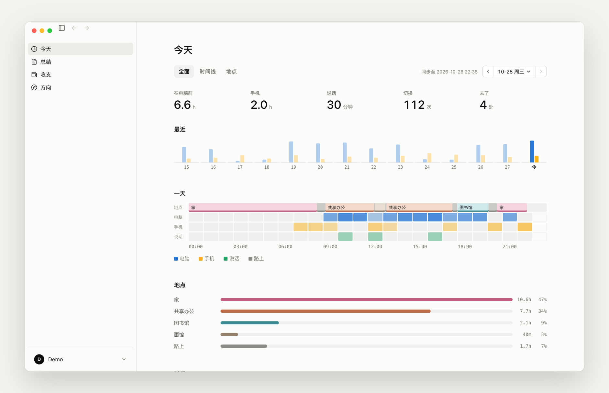
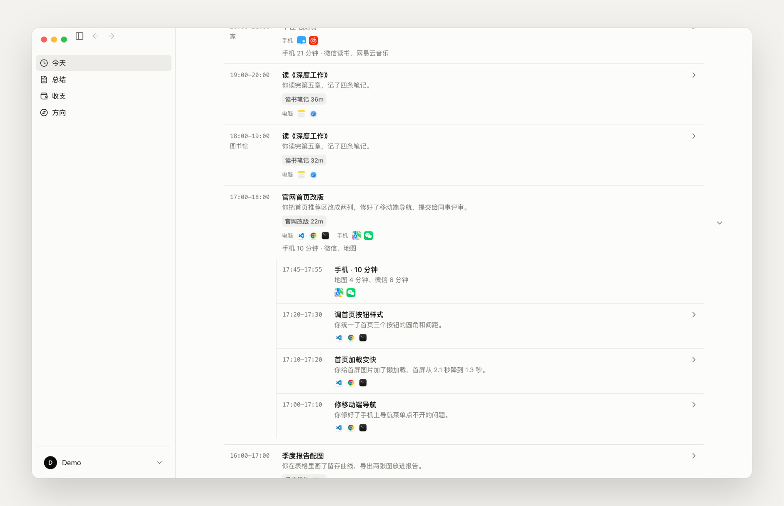
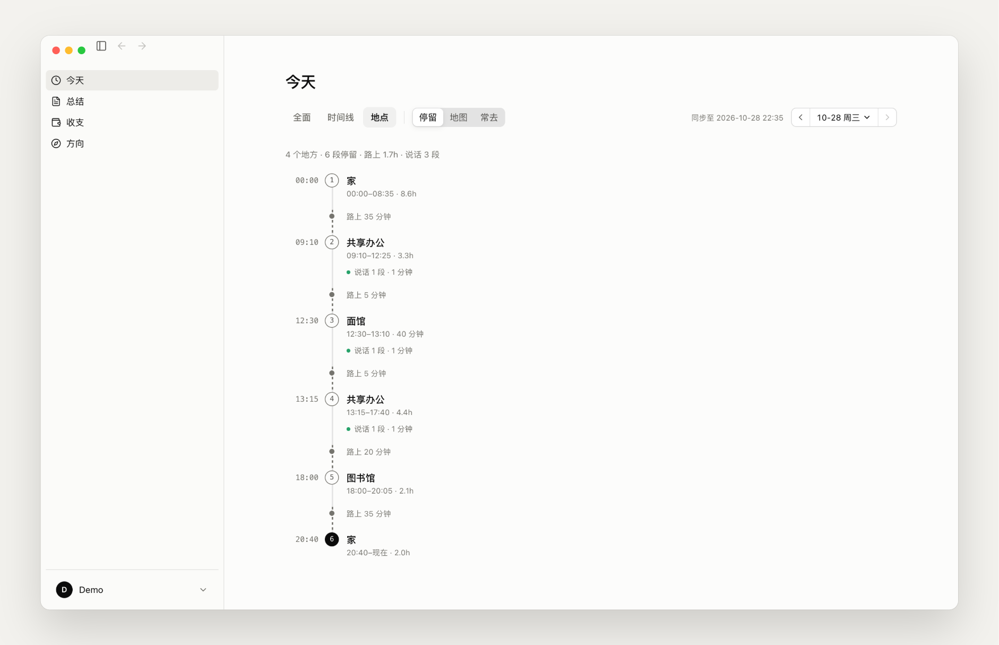
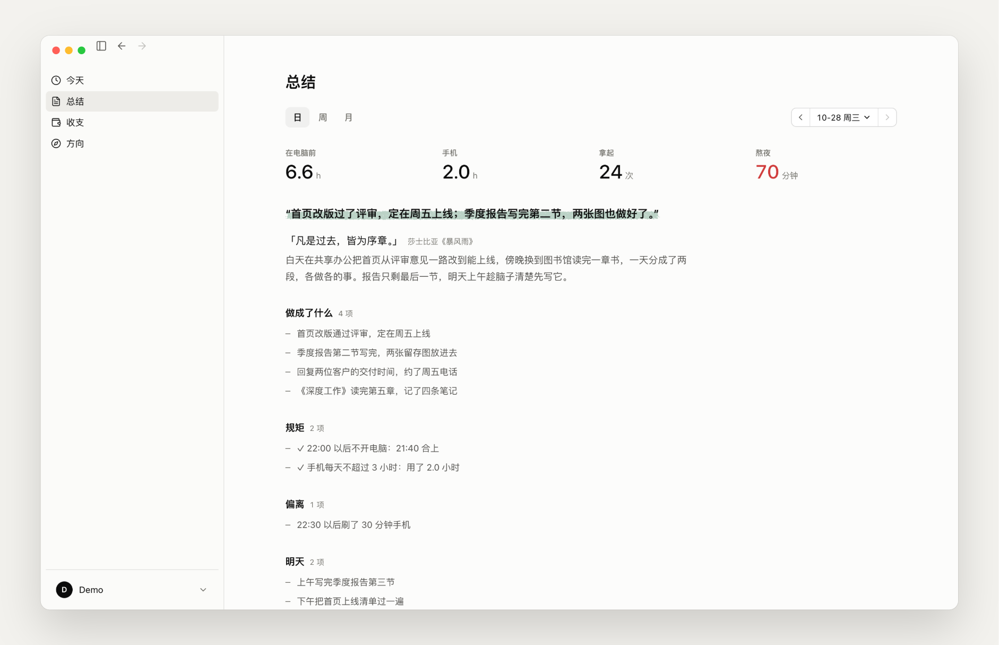
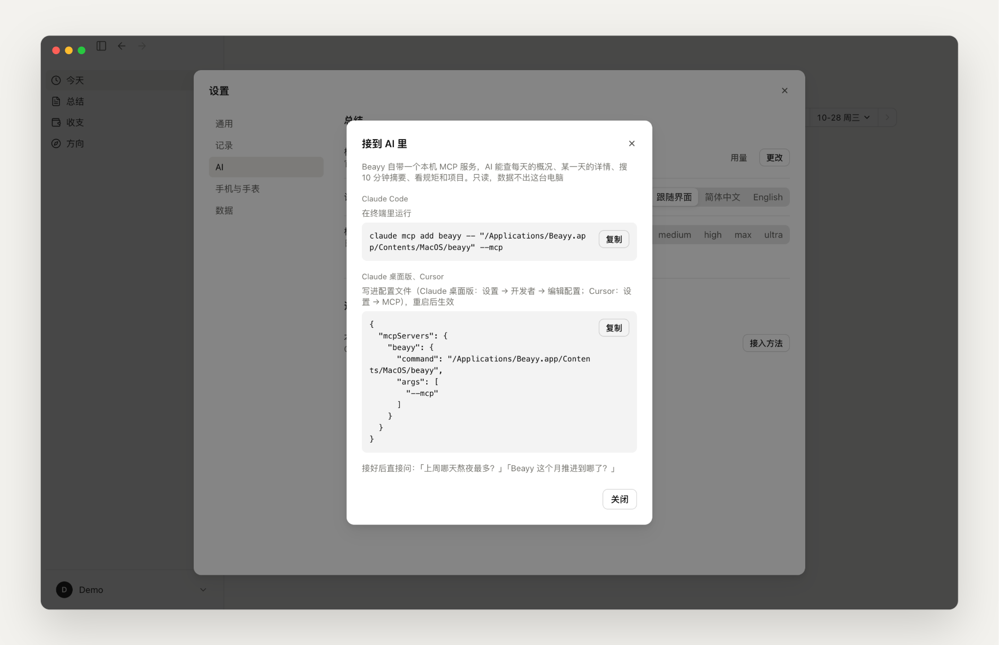
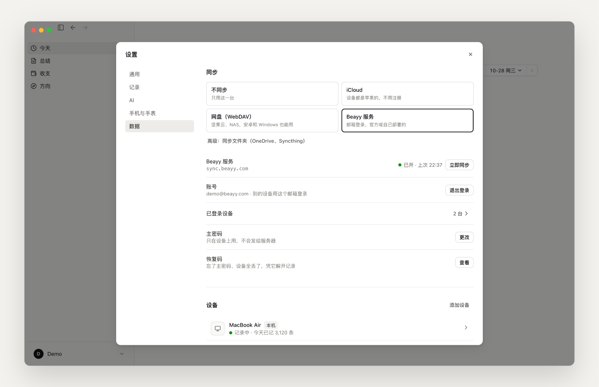

<div align="center">


# Beayy

**自动记下你的一天：几点、在哪、在做什么**

电脑、手机、手表一起记，去过的地方也记。<br>
每 10 分钟写一段摘要，每晚写一份日总结，再汇成周和月。

*Be Authentic. Your Yesterdays.*

*Beayy records your day on Mac, Windows and iPhone — when, where, and what you were doing — and writes the journal for you. Local-first, open source, self-hostable.*

**简体中文** · [English](README.en.md)

[](https://github.com/hengfengliya/beayy/releases/latest)
[](https://github.com/hengfengliya/beayy/releases)
[](https://github.com/hengfengliya/beayy/stargazers)
[](LICENSE)

[![LINUX DO](https://img.shields.io/badge/LINUX-DO-FFB003.svg?logo=data:image/svg%2bxml;base64,DQo8c3ZnIHhtbG5zPSJodHRwOi8vd3d3LnczLm9yZy8yMDAwL3N2ZyIgd2lkdGg9IjEwMCIgaGVpZ2h0PSIxMDAiPjxwYXRoIGQ9Ik00Ni44Mi0uMDU1aDYuMjVxMjMuOTY5IDIuMDYyIDM4IDIxLjQyNmM1LjI1OCA3LjY3NiA4LjIxNSAxNi4xNTYgOC44NzUgMjUuNDV2Ni4yNXEtMi4wNjQgMjMuOTY4LTIxLjQzIDM4LTExLjUxMiA3Ljg4NS0yNS40NDUgOC44NzRoLTYuMjVxLTIzLjk3LTIuMDY0LTM4LjAwNC0yMS40M1EuOTcxIDY3LjA1Ni0uMDU0IDUzLjE4di02LjQ3M0MxLjM2MiAzMC43ODEgOC41MDMgMTguMTQ4IDIxLjM3IDguODE3IDI5LjA0NyAzLjU2MiAzNy41MjcuNjA0IDQ2LjgyMS0uMDU2IiBzdHlsZT0ic3Ryb2tlOm5vbmU7ZmlsbC1ydWxlOmV2ZW5vZGQ7ZmlsbDojZWNlY2VjO2ZpbGwtb3BhY2l0eToxIi8+PHBhdGggZD0iTTQ3LjI2NiAyLjk1N3EyMi41My0uNjUgMzcuNzc3IDE1LjczOGE0OS43IDQ5LjcgMCAwIDEgNi44NjcgMTAuMTU3cS00MS45NjQuMjIyLTgzLjkzIDAgOS43NS0xOC42MTYgMzAuMDI0LTI0LjM4N2E2MSA2MSAwIDAgMSA5LjI2Mi0xLjUwOCIgc3R5bGU9InN0cm9rZTpub25lO2ZpbGwtcnVsZTpldmVub2RkO2ZpbGw6IzE5MTkxOTtmaWxsLW9wYWNpdHk6MSIvPjxwYXRoIGQ9Ik03Ljk4IDcwLjkyNmMyNy45NzctLjAzNSA1NS45NTQgMCA4My45My4xMTNRODMuNDI2IDg3LjQ3MyA2Ni4xMyA5NC4wODZxLTE4LjgxIDYuNTQ0LTM2LjgzMi0xLjg5OC0xNC4yMDMtNy4wOS0yMS4zMTctMjEuMjYyIiBzdHlsZT0ic3Ryb2tlOm5vbmU7ZmlsbC1ydWxlOmV2ZW5vZGQ7ZmlsbDojZjlhZjAwO2ZpbGwtb3BhY2l0eToxIi8+PC9zdmc+)](https://linux.do/t/topic/3081565)

[下载 Mac / Windows / 安卓版](https://github.com/hengfengliya/beayy/releases/latest) · [iPhone 和手表（TestFlight）](https://testflight.apple.com/join/Ptzqu4q8) · [beayy.com](https://beayy.com)


</div>

每天晚上回想「今天到底干了啥」，常常想不起来。屏幕使用时间只告诉你用了几小时 Chrome，说不清在 Chrome 里做了什么。Beayy 在后台记下电脑、手机和手表上的事，让模型替你写流水账，你只管看。

## 一天的形状

在电脑前多久、手机多久、切了多少次 app、去了几个地方。「一天」按小时排开地点、睡眠、电脑、手机和说话，时间按项目和类型归好类。

装了 iPhone app 还能接苹果健康：昨晚几点睡、几点醒、睡了多久，当天走了多少步、锻炼了多久。

<p align="center"></p>

## 每 10 分钟一段

时间线按小时列出在做什么，点开一小时，能看到每 10 分钟的摘要、用了哪些 app、那会儿拿起手机做了什么。

<p align="center"></p>

## 去了哪

装上 iPhone app，记下每天到过哪些地方、几点到几点走，自动认出是哪家店，常去的地方可以起名。只记停留点，不记路上的轨迹。

<p align="center"></p>

## 日、周、月总结

每晚写日总结：一句话、一段点评（引一句诗文或名人的话）、做成了什么、偏离了什么、明天做什么，再加上这天去了哪、时间花在哪。一周过完写周总结，一个月过完写月总结。iPhone 数据晚到了，点「重新生成」重写。

规矩用自己的话写，比如「22:00 以后不开电脑」「手机每天不超过 3 小时」，总结里当天对照。

<p align="center"></p>

## 问你自己的过去

Beayy 自带一个本机 MCP 服务。接到 Claude Code、Claude 桌面版或 Cursor 以后，直接问「上周三下午我在忙什么」「这个月哪天熬夜最多」。只读，数据不出这台电脑。

```bash
claude mcp add beayy -- "/Applications/Beayy.app/Contents/MacOS/beayy" --mcp
```

Claude 桌面版、Cursor 的配置在「设置 → 连接 → 接到 AI 里」，复制粘贴即可。提供的工具：`list_days`（最近每天概况）、`get_day`（某天的时长、每小时在做什么、时间花在哪、日总结）、`search`（在 10 分钟摘要里搜关键词）、`get_rules_and_projects`。

<p align="center"></p>

## 数据在你手里

记录全部存在本机。多台设备之间要同步，有三种方式：

- **官方服务器**：开放注册，不要邀请码，每个账号 100MB 同步空间，送官方模型每月 5 万 token，先开 50 个名额
- **自己部署**：服务端代码在 [`server/`](server/README.md)，`docker compose up -d` 就能起
- **同步文件夹**：选一个 iCloud 云盘、OneDrive、坚果云、Syncthing 这类会同步的文件夹，不经过任何服务器

不管哪种，记录都在本机压缩、加密后再传出去，服务器和网盘只拿到密文。不同步也能用。

<p align="center"></p>

## 记什么、存在哪

| | |
|---|---|
| 电脑 | 切到哪个 app 和窗口、打字和发出去的内容、点了什么、滚动、屏幕上的文字（macOS 辅助功能、Windows UI Automation 读取）、在不在电脑前、睡眠锁屏。密码框不记；可以指定某些 app 完全不记；可以随时暂停、删掉最近 15 分钟／1 小时／今天的记录 |
| 手机 | iPhone 经 iCloud 同步到 Mac 的屏幕使用时间：每个 app 什么时候在前台、用了多久，看不到 app 里的内容；安卓手机由 Beayy 安卓 app 自己读（使用情况访问权限），加密后经同步传到电脑 |
| 位置（可选） | iPhone app 记下的停留点（几点到、几点走、地名），加密后经同步传到电脑；路上的轨迹不记 |
| 健康（可选） | iPhone app 只读苹果健康（睡眠、步数、活动、锻炼、心率、心情等），加密后经同步传到电脑，今天页汇成昨晚睡眠和当天活动；日总结不写心率、心情这类细项 |
| 手表（可选） | Apple Watch 全天录音，传到转写服务（官方的或你自己部署的）转写、分说话人；电脑上只有文字（谁在几点说了什么） |
| 存储 | 全部在本机 `~/Library/Application Support/Beayy/`，按设备、每 10 分钟一个文件，只追加 |
| 摘要 | 把那 10 分钟的记录发给**你配置**的模型（任何 OpenAI 兼容接口，或官方服务），写回本机。「设置 → 连接 → 模型 → 用量」看每天花了多少 token |
| 同步（可选） | 本机压缩、XChaCha20-Poly1305 加密后上传；主密码只在设备上用（Argon2id 派生），服务器只存密文和登录校验值的哈希 |

## 安装

到 [Releases](https://github.com/hengfengliya/beayy/releases/latest) 下载 `Beayy-<版本>.dmg`，拖进「应用程序」打开；Windows 下载 `Beayy-<版本>-windows-x64-setup.exe` 安装，会建桌面和开始菜单快捷方式、开机自动启动。第一次打开会带你走一遍：授权（辅助功能、输入监控、可选的完全磁盘访问）、填模型、要不要同步。装好以后会自动检查更新，新版本下好后弹窗提示，点「重启更新」几秒就换好。

界面有简体中文和英文：设置 → 通用 → 语言，默认跟随系统。

iPhone 和 Apple Watch app 走 TestFlight 公开测试：https://testflight.apple.com/join/Ptzqu4q8 （源码在 [`ios/`](ios/)）。

安卓 app（试用）：在 Releases 下载 `Beayy-<版本>-android.apk` 装上，登录和电脑同一个账号，在 设置 → 通用 → 这台手机 允许读取使用情况。现在记每个 app 用了多久，还不记位置（源码在 [`android/`](android/)）。

要求 macOS 14 以上，或 Windows 10／11（64 位）。

## 还不支持的

- Linux 电脑；安卓 app 还不记位置、没有正式签名
- iPhone 的屏幕使用时间只能在 Mac 上读；只有 Windows 电脑的话，看不到手机用了哪些 app（位置不受影响）
- Windows 版还在试用：没有代码签名，第一次运行 SmartScreen 会拦，点「更多信息 → 仍要运行」；杀毒软件可能把键盘钩子当成键盘记录器，放行即可；以管理员身份运行的程序读不到（Beayy 不提权）
- 官方送的模型额度每月 5 万 token，只够试用（一段 10 分钟摘要约 6 千 token），天天用要自己配模型；转写、地图不送
- 摘要和日、周、月总结暂时只用中文写；英文界面里，这部分和服务端发来的提示也还是中文

## 从源码编译

```bash
# Rust（rustup）和 Xcode 命令行工具
git clone https://github.com/hengfengliya/beayy && cd beayy
./build.sh            # 测试版：编译、签名（有 Developer ID 证书就用，没有就本机临时签名）、装成 Beayy-rs.app 并启动，写独立的影子目录，可以和正式版同时跑
./build.sh --install  # 装成 ~/Applications/Beayy.app（正式版，写正式数据目录；会覆盖已装的 Beayy）
./build.sh --dmg      # 打安装包 target/Beayy-<版本>.dmg；用 Developer ID 签名并给了公证凭据就自动公证
```

iPhone 和手表 app（要 Xcode 26、[XcodeGen](https://github.com/yonaskolb/XcodeGen)，Rust 加上 `aarch64-apple-ios`、`aarch64-apple-ios-sim` 两个目标）：

```bash
cd ios && xcodegen          # 生成 BeayyRecorder.xcodeproj；project.yml 里的 DEVELOPMENT_TEAM 换成自己的
open BeayyRecorder.xcodeproj  # 选 BeayyPhone 运行，编译前会自动编 Rust 核心
```

安卓 app（要 JDK 17、Android SDK 35 和 NDK 27、[cargo-ndk](https://github.com/bbqsrc/cargo-ndk)，Rust 加上 `aarch64-linux-android`、`x86_64-linux-android`）：

```bash
cd android && ./build.sh      # 出 app/build/outputs/apk/debug/app-debug.apk；./build.sh release 出发布包
```

只看界面：用浏览器打开 `ui/index.html`，读 `ui/mock/` 里的虚构样例数据（`python3 ui/mock/make_mock.py` 重新生成）。

<details>
<summary>代码结构</summary>

| 目录 | 内容 |
|---|---|
| `crates/beayy-core` | 事件格式与写入（按设备、UTC 整 10 分分段、只追加）、设备名、数据目录 |
| `crates/beayy-capture` | 采集：键鼠、打字与发送、界面文字、切 app、在场与心跳、睡眠锁屏；macOS 用辅助功能和事件监听，Windows 用低级钩子和 UI Automation，判断逻辑两边共用（`common.rs`） |
| `crates/beayy-phone` | 读 iPhone 经 iCloud 同步来的屏幕使用时间（macOS） |
| `crates/beayy-remote` | 从录音服务器拉手表对话转写和 iPhone 停留点（HTTPS＋口令） |
| `crates/beayy-summary` | 10 分钟摘要、小时摘要、两级分类（类型、领域 · 项目）、项目名合并 |
| `crates/beayy-sync` | 多设备同步客户端：账号、加密、上传下载、同步文件夹 |
| `src-tauri` | Tauri 2 外壳：菜单栏、主窗口、给网页的命令（`src-tauri/COMMANDS.md`）、定时任务、日周月总结、MCP 服务 |
| `ui` | 网页界面：纯 HTML＋CSS＋JS，电脑和 iPhone 共用；简体中文和英文（`i18n.js`、`locales/`） |
| `mobile` | iPhone 版的 Rust 核心（静态库），直接编 `src-tauri` 的数据代码，和电脑同一份 |
| `android` | 安卓 app 的 Kotlin 外壳：读每个 app 的使用时长、经 JNI 调同一个 Rust 核心；界面是网页视图加载 `ui/` |
| `ios` | iPhone 和 Apple Watch app 的 Swift 外壳（XcodeGen）：定位记停留点、手表录音、登录账号加密上传；界面是网页视图加载 `ui/` |
| `server` | 服务端：同步（只存密文）＋录音转写＋可选的模型、地图代理，Python（FastAPI＋SQLite＋本地文件）。用 Docker 在自己的电脑或服务器上跑，见 [`server/README.md`](server/README.md)；官方实例跑的也是它 |
| `sync-server` | 同步服务的旧 Cloudflare 版（Workers＋R2＋D1），接口和 `server` 相同，不再维护 |
| `docs/images` | README 里的图，界面里是虚构的样例数据 |

</details>

## Star 趋势

<p align="center">
<a href="https://www.star-history.com/#hengfengliya/beayy&Date">
  <picture>
    <source media="(prefers-color-scheme: dark)" srcset="https://api.star-history.com/svg?repos=hengfengliya/beayy&type=Date&theme=dark">
    
  </picture>
</a>
</p>

## 反馈

有 bug 或想要的功能，开 [issue](https://github.com/hengfengliya/beayy/issues)，或者到 [linux.do 的帖子](https://linux.do/t/topic/3081565)里说。

## 许可

MIT，见 [LICENSE](LICENSE)。用到的第三方代码见 [THIRD_PARTY_NOTICES.md](THIRD_PARTY_NOTICES.md)。
